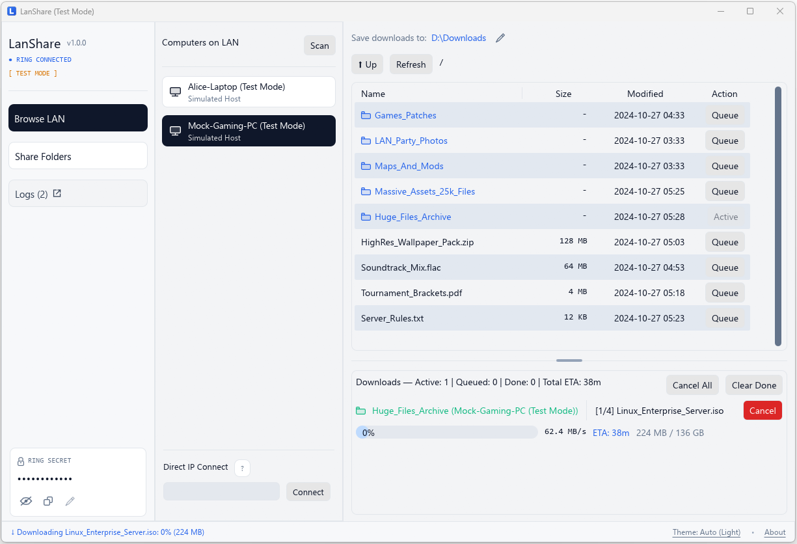
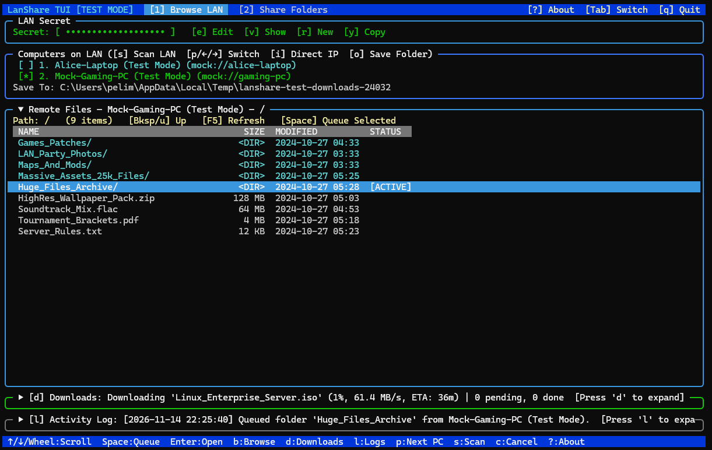
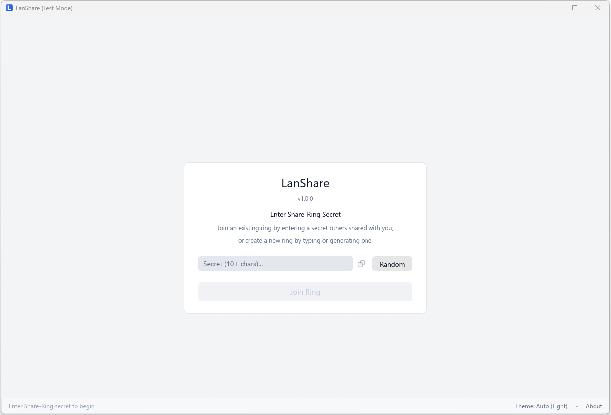
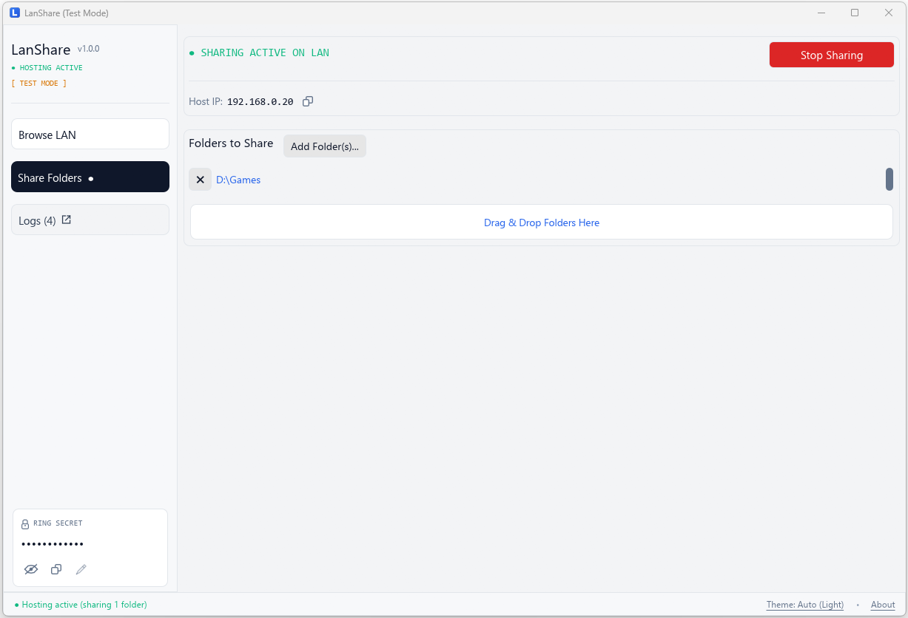
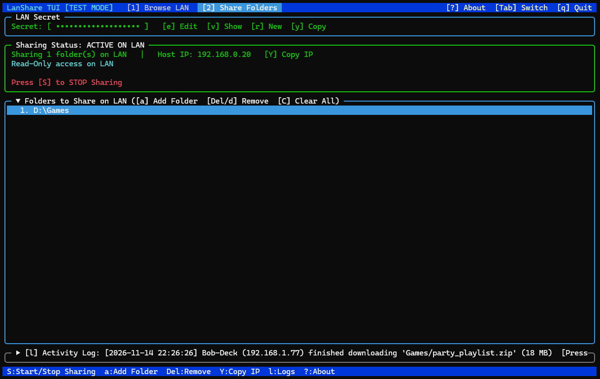

# LanShare

A zero-config, portable desktop (**GUI**) and terminal (**TUI** & **CLI**) app for **Windows & Linux** designed for fast, strictly read-only file and folder sharing across your local network (or Tailscale) using a shared **Share-Ring** secret.

Built in **Rust** from a single shared core powering both a lightweight native GUI (`lanshare-gui`) and an interactive Terminal UI / command-line tool (`lanshare-cli`).

---

## Table of Contents

- [How the Share-Ring Works](#how-the-share-ring-works)
- [Key Features](#key-features)
- [Screenshots](#screenshots)
- [Download](#download)
- [Usage](#usage)
  - [GUI (`lanshare-gui`)](#gui-lanshare-gui)
  - [Terminal UI (TUI) & Direct CLI (`lanshare-cli`)](#terminal-ui-tui--direct-cli-lanshare-cli)
  - [Connecting Across Tailscale (Remote Peers)](#connecting-across-tailscale-remote-peers)
- [Security & How It Works](#security--how-it-works)
- [Building from Source](#building-from-source)

---

## How the Share-Ring Works

Instead of configuring IP addresses, user accounts, or SMB shares:

1. **Start the Ring**: Enter (or generate) a shared secret phrase of at least **10 characters** (e.g., `abcd-efgh-42`).
2. **Join the Ring**: Anyone else on your network enters that **exact same secret** in their GUI or TUI app.
3. **Browse & Download**: Peers automatically find each other on the LAN. Add one or more folders or files in **Share Files** and sharing starts automatically.

---

## Key Features

* **GUI, TUI & Direct CLI from One Core**:
  * **`lanshare-gui` (GUI)**: Native desktop app with drag-and-drop file & folder hosting, live upload progress, resizable **Downloads** & **Uploads** panels, and multi-instance peer support.
  * **`lanshare-cli` (TUI & CLI)**: Interactive terminal UI with mouse-free navigation, collapsible **Downloads** (`d`) and **Uploads** (`u`) progress panels, plus direct one-shot CLI subcommands (`host`, `peers`, `ls`, `download`)—great over SSH or on headless Linux machines.
* **No Installation or Admin Rights Needed**: Single self-contained portable executable with zero external dependencies, installers, or background services.
* **Zero-Config Discovery**: No servers, accounts, cloud relays, or manual port forwarding needed on a LAN.
* **Queue Entire Folders with Auto-Resume**: Download single files or full directory trees sequentially with automatic resume on interrupted transfers.
* **Tailscale & WireGuard Ready**: Connect directly to remote peers across private tailnets (`100.64.0.0/10` and IPv6 ULA) via **Direct IP Connect**.
* **Single-User Test Mode (`--test`)**: Try out browsing, peer switching, and transfers on one machine using built-in simulated peers.

---

## Screenshots

### Desktop GUI (`lanshare-gui`)


### Terminal UI (`lanshare-cli`)


<details>
<summary>More Screenshots (Login & Share Files)</summary>

#### GUI — Share-Ring Login


#### GUI — Share Files (Hosting)


#### TUI — Share Files (Hosting)


</details>

---

## Download

Download the latest portable binaries directly from **[GitHub Releases](https://github.com/jokkeheikkila/LanShare/releases)**

* **Windows (x64)**: `lanshare-gui-windows-x64.exe` (GUI) and `lanshare-cli-windows-x64.exe` (TUI & CLI) — portable, zero external DLLs.
* **Linux (x64)**: `lanshare-gui-linux-x64` (GUI) and `lanshare-cli-linux-x64` (TUI & CLI) — X11 & Wayland, built against Ubuntu 22.04 `glibc` for broad distro compatibility.

*(Binaries are built automatically by [GitHub Actions](.github/workflows/build.yml). On Linux, run `chmod +x lanshare-gui-linux-x64 lanshare-cli-linux-x64` before launching.)*

---

## Usage

Because LanShare is a portable standalone executable (not installed into your system `PATH` unless you copy it there), launch it from the directory containing the binary using `./lanshare-gui` or `./lanshare-cli` (or `./lanshare-gui-linux-x64` / `.\lanshare-cli-windows-x64.exe` for the release downloads):

### GUI (`lanshare-gui`)
```bash
# Normal LAN mode
./lanshare-gui

# Offline UI test mode (2 simulated LAN hosts)
./lanshare-gui --test
```

### Terminal UI (TUI) & Direct CLI (`lanshare-cli`)

`lanshare-cli` works both as an interactive Terminal UI (when run with no subcommand or `tui`) and as a direct command-line tool (`host`, `peers`, `ls`, `download`) that prints all logs directly to the terminal without writing log files to disk. By default, direct CLI commands prompt you to enter the Share-Ring secret on `stdin` (keeping it out of shell history and process lists):

```bash
# Interactive TUI
./lanshare-cli
./lanshare-cli --test

# Direct CLI: Host folders or files read-only in the foreground (prompts for ring secret, then prints live status until Ctrl+C)
./lanshare-cli host ~/Downloads ~/Videos

# Direct CLI: Discover active peers on the Share-Ring
./lanshare-cli peers

# Direct CLI: List root share or a deeper directory on a specific host
./lanshare-cli ls --peer Gaming-PC
./lanshare-cli ls --peer 192.168.1.50 LAN_Party_Photos/Day_1

# Direct CLI: Download multiple files or folders sequentially (no wildcards) and exit when done
./lanshare-cli download --peer Gaming-PC -d ~/Downloads Games_Patches Tournament_Brackets.pdf
```

To avoid retyping the Share-Ring secret on every direct CLI command (or when starting the TUI with `--autostart`), set the `LANSHARE_SECRET` environment variable once for your current terminal session:

```bash
# Linux (bash / zsh)
export LANSHARE_SECRET="lan-party-42"
```

```powershell
# Windows 11 Terminal (PowerShell)
$env:LANSHARE_SECRET = "lan-party-42"
```

```cmd
:: Windows Command Prompt (cmd.exe)
set LANSHARE_SECRET=lan-party-42
```

<details>
<summary>CLI Subcommands & Flags Reference (<code>lanshare-cli --help</code>)</summary>

```text
LanShare CLI & TUI (lanshare-cli) — Encrypted zero-config LAN folder sharing powered by Share-Ring

USAGE:
  lanshare-cli [TUI_OPTIONS]
  lanshare-cli tui [TUI_OPTIONS]
  lanshare-cli host <PATH>...
  lanshare-cli peers
  lanshare-cli ls --peer <HOSTNAME_OR_IP> [REMOTE_PATH]
  lanshare-cli download --peer <HOSTNAME_OR_IP> [-d <DEST_DIR>] <REMOTE_PATH>...

COMMANDS:
  tui                   Launch the interactive Terminal UI (default when no command is given)
  host, share           Share one or more local folders or files read-only and print live status
  peers, scan           Discover and list active hosts on the Share-Ring
  ls, list              List shared folders or directory contents on a remote host
  download, get         Download one or more files or folders from a remote host (no wildcards)

SECRET OPTIONS (prompts for secret on stdin by default if omitted and LANSHARE_SECRET is not set):
  --secret-stdin              Prompt / read Share-Ring secret from standard input (default; min 10 chars)
  --secret-env <VAR>          Read Share-Ring secret from environment variable (min 10 chars)
  -s, --secret <SECRET>       Pass Share-Ring secret directly (min 10 chars)

CLIENT OPTIONS (for `ls` and `download`):
  -p, --peer <HOST_OR_IP>     Target host name or IP address (required for `ls` and `download`)
  -d, --dest <DIR>            Local destination directory for `download` (default: current directory `.`)

GENERAL & TUI OPTIONS:
  --test, --mock              Use simulated LAN peers / simulated friend downloads
  --host <FOLDER>             (TUI mode) Pre-add a local folder to the Host tab (can be passed multiple times)
  --autostart                 (TUI mode) Automatically start Read-Only hosting on startup (with --host)
  -V, --version               Print version information
  -h, --help                  Print this help message
```

</details>

<details>
<summary>TUI Keyboard Shortcuts</summary>

| Key | Action |
| :--- | :--- |
| `Tab` | Switch between **Browse LAN (Client)** and **Share Files (Host)** tabs |
| `?` / `F1` | Open **About LanShare & How LanShare Works** modal |
| `e` / `v` / `r` / `Y` | **Edit**, **Show/Hide**, **Randomize**, or **Copy** the Share-Ring Secret / Host IP |
| `↑` / `↓` / `PgUp` / `PgDn` | Navigate files/folders in the browser or shared folder list |
| `Enter` | Open highlighted folder in Browse |
| `Space` | Queue highlighted file **or entire folder** for sequential download |
| `Backspace` / `u` / `F5` | (Browse Tab) Navigate up to parent directory (`Backspace`/`u`) or **Refresh** listing (`F5`) |
| `p` / `←` / `→` | Cycle between discovered Share-Ring peers |
| `s` / `i` / `o` | **Scan** LAN, connect via **Direct IP**, or change local **Download Folder** |
| `b` / `d` | (Client Tab) Expand **Browse** (`b`) or expand/collapse **Downloads** (`d`) |
| `c` / `Del` / `x` | (Downloads) **Cancel** active transfer, **Remove** pending queue item, or **Clear** finished items |
| `a` / `F` / `Del` / `C` / `S` | (Host Tab) **Add** folder (`a`), **Add** file (`F`), **Remove** item (`Del`), **Clear** list (`C`), or **Start/Stop** sharing (`S`) |
| `u` / `f` | (Host Tab) Expand/collapse **Uploads** panel (`u`) or return to **Folders** (`f`) |
| `←` / `→` / `Home` / `End` | (Input Dialogs) Move cursor within path or secret |
| `F2` | (Setup & Input Dialogs) **Copy** field to clipboard (also clickable on login setup) |
| `Ctrl+V` / `Shift+Ins` | (Setup & Input Dialogs) **Paste** (replace text from clipboard) |
| `Ctrl+U` / `Del` | (Setup & Input Dialogs) Clear entire input or delete character under cursor |
| `l` | Show/hide **Activity Logs** panel (Client or Host tab) |
| `q` / `Esc` | Collapse expanded panel back to Browse/Folders (`Esc`), or **Quit** application |

</details>

### Connecting Across Tailscale (Remote Peers)

1. Enter the **exact same Share-Ring secret** on both machines.
2. Add at least one folder or file on the host in **Share Files** (sharing starts automatically).
3. Connect using the host's Tailscale IP (e.g. `100.115.92.19`) under **Direct IP Connect** in the GUI (or press `i` in the TUI).
4. Browse and download over the same mutual TLS encryption—no UDP broadcast needed.

<details>
<summary>Tailscale ACL ports (only needed if your tailnet uses custom ACL rules)</summary>

If your tailnet restricts traffic in [Tailscale Access Controls](https://login.tailscale.com/admin/acls), allow these ports between LanShare nodes:

* **TCP Port `22222`**: Encrypted TLS file transfers and directory listings.
* **UDP Port `22223`**: Cryptographic discovery probes and reverse connection requests.

</details>

---

## Security & How It Works

LanShare is designed to stay simple to run while keeping both host and downloader safe on shared local networks:

* **Strictly Read-Only by Design**: The protocol only supports listing shared items and streaming existing files. There is no upload, rename, overwrite, delete, or remote-command endpoint.
* **Zero-Plaintext Secret Authentication**: Your Share-Ring secret (minimum 10 characters) never crosses the network. Keys are derived with **PBKDF2-HMAC-SHA256** (`100,000` rounds), and every connection uses an in-memory ephemeral **TLS 1.3 / 1.2** session (`rustls` + `ring`) with mutual channel-bound verification.
* **Resumable & Verified Transfers**: Files stream in 64 KB chunks over TLS with strict byte-offset resume and end-of-stream **SHA-256** checksum verification.
* **Path & Symlink Protection**: Hosts cannot accidentally share filesystem roots, OS folders, or home directories, and both host and client block `..` traversal, Windows reserved device names, and symlink/junction escapes.
* **Private Networks Only**: Connections are restricted to private LAN, loopback/link-local, and WireGuard/Tailscale (`100.64.0.0/10`, `fc00::/7`) ranges—no UPnP, NAT-PMP, or cloud relays. Repeated failed logins are automatically rate-limited.
* **Zero-Config Firewall Traversal**: Uses lightweight LAN discovery on **UDP `22223`** and encrypted transfers on **TCP `22222`** (with automatic free-port fallback and outbound reverse-TCP callbacks so desktop firewalls work without root/admin rights).

For technical security details, automation flags (`--secret-env`, `--secret-stdin`), and vulnerability reporting, see [SECURITY.md](SECURITY.md).

---

## Building from Source

Requires [Rust](https://rustup.rs/) (2021 Edition). On Windows, also install Visual Studio C++ Build Tools.

<details>
<summary>Linux build dependencies (Ubuntu/Debian, Arch, Fedora)</summary>

```bash
# Ubuntu / Debian
sudo apt install build-essential pkg-config libxkbcommon-dev libwayland-dev libx11-dev libxcursor-dev libxi-dev libxrandr-dev libxinerama-dev libgl1-mesa-dev libegl1-mesa-dev

# Arch Linux
sudo pacman -S base-devel libxkbcommon wayland libx11 libxcursor libxi libxrandr libxinerama mesa

# Fedora
sudo dnf install @development-tools libxkbcommon-devel wayland-devel libX11-devel libXcursor-devel libXi-devel libXrandr-devel libXinerama-devel mesa-libGL-devel mesa-libEGL-devel
```

</details>

```bash
git clone https://github.com/jokkeheikkila/LanShare.git
cd LanShare
cargo build --release --locked
```

This produces `target/release/lanshare-gui` (`lanshare-gui.exe` on Windows) and `target/release/lanshare-cli` (`lanshare-cli.exe` on Windows).
